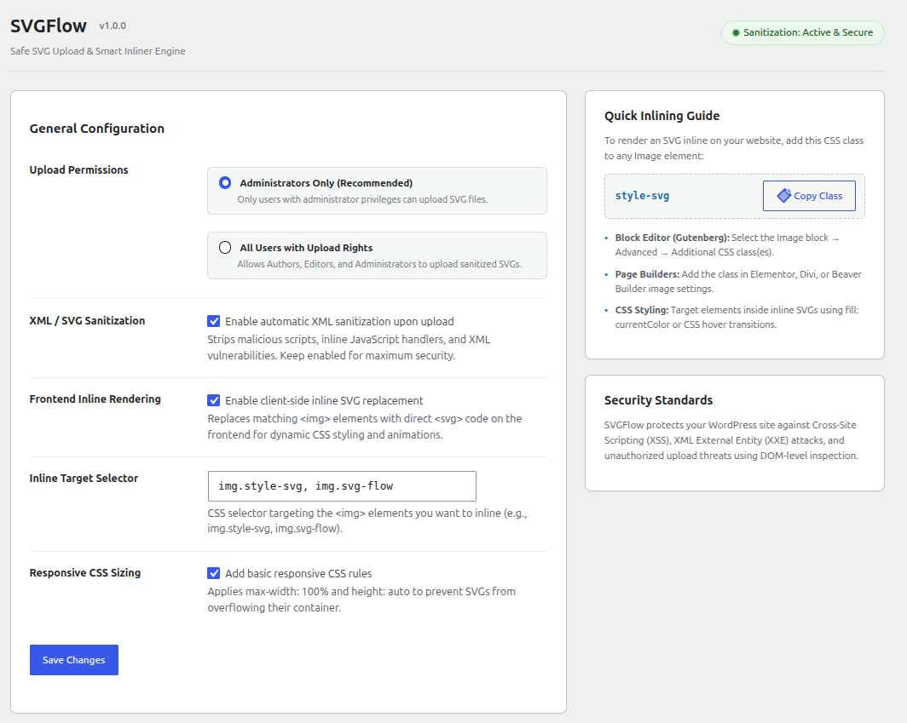

# Svigent SVG Engine

[](https://wordpress.org/plugins/svigent-tools/)
[](https://wordpress.org/plugins/svigent-tools/#reviews)
[](https://wordpress.org)
[](https://php.net)
[](https://www.gnu.org/licenses/gpl-2.0.html)
[](https://wordpress.org/plugins/plugin-check/)

Upload SVG files to WordPress safely. **Svigent SVG Engine** sanitizes every SVG and SVGZ upload, fixes Media Library previews, and turns SVG images into inline SVG you can style with CSS.

**[Download Svigent SVG Engine from WordPress.org →](https://wordpress.org/plugins/svigent-tools/)**

> **Development Repository**
>
> This GitHub repository is the development workspace for Svigent SVG Engine. For production sites, install the official release from the [WordPress.org plugin directory](https://wordpress.org/plugins/svigent-tools/).
>
> Releases are published to WordPress.org via SVN; this repository is used for version control, issue tracking, and future enhancements.

---

## Description

**Svigent SVG Engine** enables safe SVG (Scalable Vector Graphics) and compressed SVGZ uploads in WordPress with automated DOM-level XML sanitization, native Media Library thumbnail fixes, dimension calculation, and fast frontend inlining.

---

## Screenshot

<p align="center">
  
</p>

---

## Key Features

* **Enterprise-Grade DOM Sanitization:** Automated XML inspection powered by `enshrined/svg-sanitize` to strip malicious scripts, event listeners, and dangerous entities before files reach your disk.
* **Native Media Library Previews:** Automatically fixes broken 1x1 or invisible SVG thumbnails in both Grid and List views in `wp-admin/upload.php`.
* **Automatic Dimension Detection:** Parses `viewBox` and `width`/`height` coordinates on upload and writes them to WordPress attachment metadata to preserve natural aspect ratios.
* **Zero-Overhead Frontend Inlining:** Replaces target `` elements with raw `<svg>` using lightweight, dependency-free Vanilla JS (about 3.5KB gzipped), enabling dynamic CSS styling (`fill: currentColor`) and hover animations.
* **Smart In-Memory Caching:** Deduplicates identical SVG network requests so repeated icons on a page are downloaded only once.
* **Dynamic DOM Observer:** Fully compatible with Gutenberg block insertion, Elementor, and AJAX infinite scroll using `MutationObserver`.
* **Role-Based Upload Permissions:** Restrict SVG upload privileges to Administrators only or extend permissions to all users with upload capabilities (Authors/Editors).
* **Lossless Vector Scaling:** Skips unnecessary raster thumbnail generation (GD/Imagick) and disables redundant `srcset` generation to conserve server disk space.

---

## Installation

1. Clone or download the repository into your WordPress plugins directory:
   ```bash
   git clone https://github.com/abineshselvarasu/svg-plugin.git wp-content/plugins/svigent-tools
   ```
2. Activate **Svigent SVG Engine** in **WordPress Admin → Plugins**.
3. Go to **Settings → Svigent SVG Engine** to configure permissions and enable inlining.

---

## Usage

### Inlining SVGs on the Frontend:
1. Ensure **"Enable client-side inline SVG replacement"** is checked in **Settings → Svigent SVG Engine**.
2. Add the class `style-svg` (or your custom selector) to any Image block or element in WordPress.
3. Svigent SVG Engine will automatically convert the `` tag into an inline `<svg>` element on the frontend, allowing full CSS styling and color control.

---

## License

Svigent SVG Engine is open-source software licensed under the [GPL-2.0-or-later](https://www.gnu.org/licenses/gpl-2.0.html).

---

## Author

Built by [Abinesh Selvarasu](https://www.abineshspotlight.online). Found a bug or have an idea? [Open an issue](https://github.com/abineshselvarasu/svg-plugin/issues) or ask on the [WordPress.org support forum](https://wordpress.org/support/plugin/svigent-tools/).
